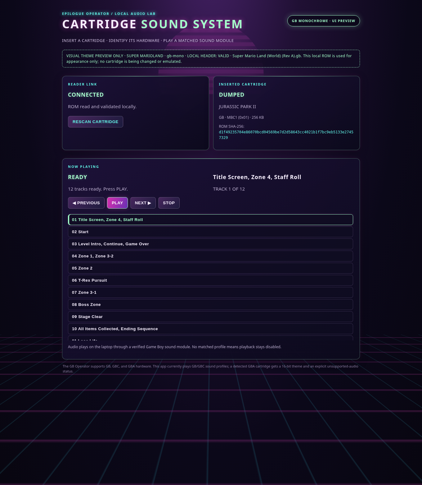
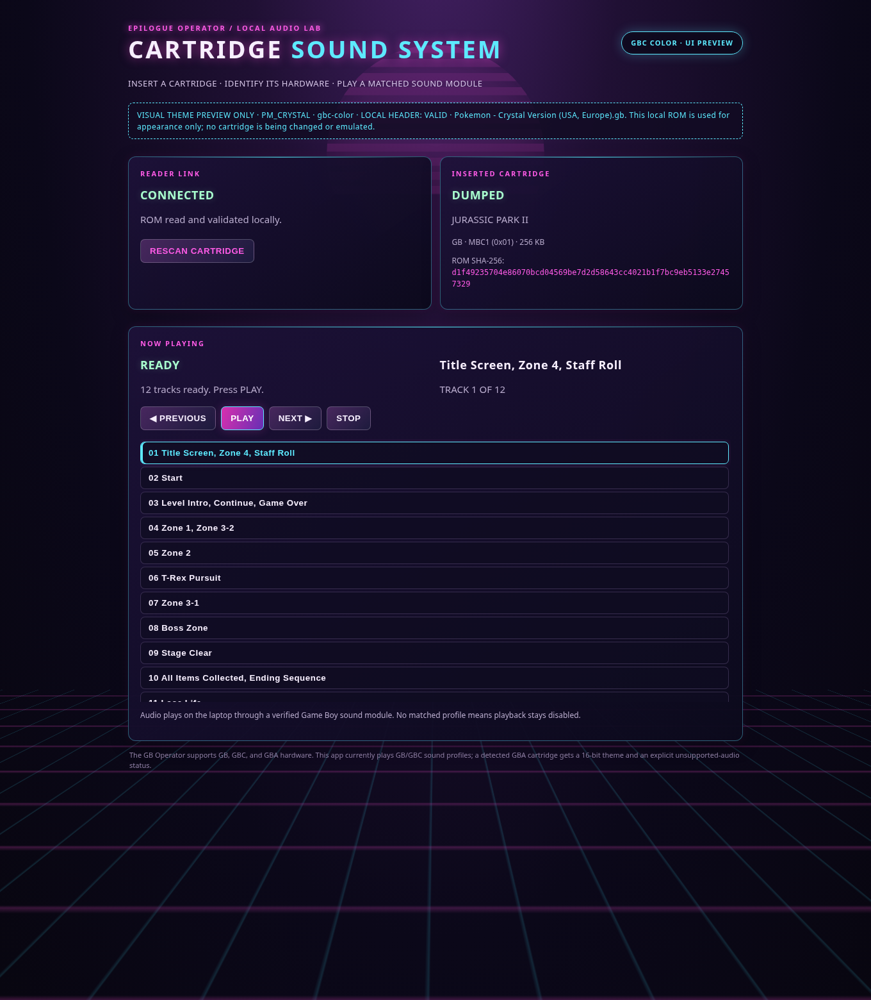
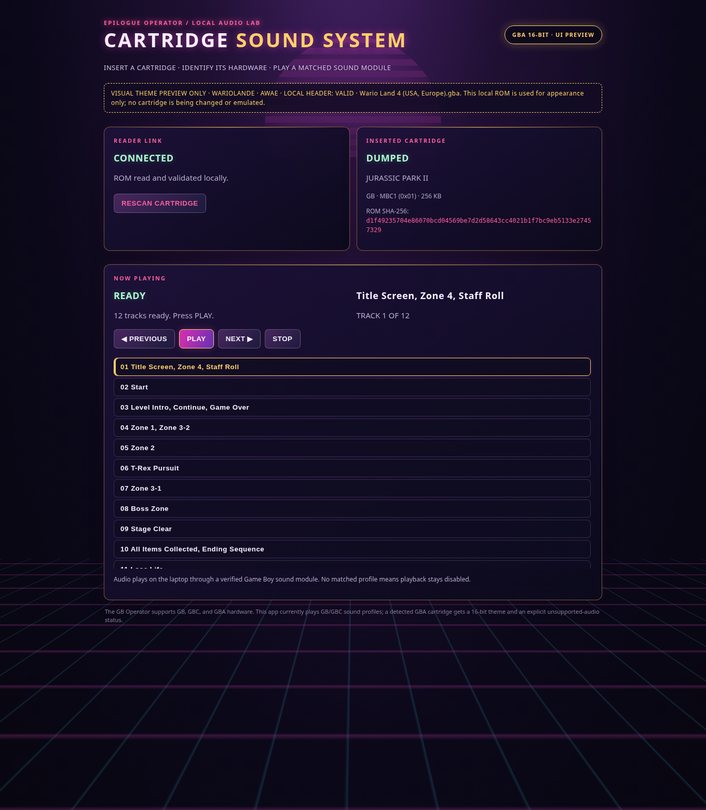

# Epilogue GB Player

A local laptop app that detects and reads an original GB/GBC cartridge through
the Epilogue GB Operator, then plays music for cartridges with a verified
playback profile. The prototype runs a small browser UI on localhost and uses
Throwback for read-only cartridge access plus gbsplay for audio.

## Run it

On this development machine, start the app with:

```sh
./run-player.sh
```

The app opens at `http://127.0.0.1:8766`. Insert a cartridge; the app polls the
Operator, reads the ROM once, validates its header and SHA-256, and loads a
matching profile. Press **PLAY**, select a track, or use previous/next. Stop the
server with Ctrl+C in the terminal where `run-player.sh` is running.

For manual startup:

```sh
python3 host-player/server.py
```

Python uses only its standard library. Throwback and gbsplay must be on `PATH`
or passed with `--throwback` and `--gbsplay`.

## Current support

Profiles currently support these exact images from the user's collection:

| Cartridge | ROM SHA-256 prefix | Tracks |
|---|---|---:|
| Operation C | `0b6670e44cc2…` | 14 |
| Jurassic Park Part 2: The Chaos Continues | `d1f49235704e…` | 12 |

The app matches the full ROM SHA-256 before enabling playback, checks each GBS
module's SHA-256, and verifies its subtune count. Track labels are shown in the
list. A module is fetched on first use and cached under
`~/.local/share/epilogue-player/gbs/`; GBS files are not included in this
source tree.

The module archives are from the [GBS Penultimate Archive](https://snesmusic.org/hoot/gbs/).
Track labels are from the [Operation C index](https://downloads.khinsider.com/game-soundtracks/album/operation-c-gb)
and [Jurassic Park 2 index](https://downloads.khinsider.com/game-soundtracks/album/jurassic-park-2-the-chaos-continues-gb).
The full ROM dump remains on the host and is never uploaded by this app.

## Presentation modes and GBA scope

The synthwave interface selects its accent palette from cartridge metadata:
the GB CGB compatibility flag produces a monochrome GB or color GBC theme, and
Throwback's GBA type/header metadata selects a 16-bit GBA theme. The GB Operator
supports GB, GBC, and GBA cartridges according to [Epilogue's official FAQ](https://www.epilogue.co/support/hardware/gb-operator-faq).
This app reads GBA identification metadata through Throwback but does not yet
dump GBA ROMs or play GBA music; it displays GBA playback as unavailable.
The live cartridge during this UI pass was Jurassic Park II (GB), so physical
GBA insertion was not tested; the GBA preview uses only the local ROM header.

The labeled theme previews read header metadata from local ROMs in
`~/games/gb` and `~/games/gba`; they do not switch cartridges, dump files, or
play those ROMs. For example, `http://127.0.0.1:8766/?ui-preview=gba` previews
the 16-bit look using the local Wario Land 4 header. The screenshots below are
UI previews captured from the running app.







Other cartridges are identified and dumped, but the app reports them as
unsupported until a matching profile exists. A profile maps exact ROM hashes
to a GBS file, its checksum, track labels, and source in
`profiles/catalog.json`. This profile system can grow without changing the UI
or the Operator code. It is not a universal ROM music extractor: many games
need driver-specific ripping work before their music can be played this way.

Both cartridges were read through the attached GB Operator and matched to the
user's local ROM backups by full SHA-256. Playback for both modules was
verified through the PulseAudio-compatible output and the app's play, pause,
resume, stop, and next-track controls. This prototype is read-only with
respect to cartridge contents; it never writes ROM or save data.
